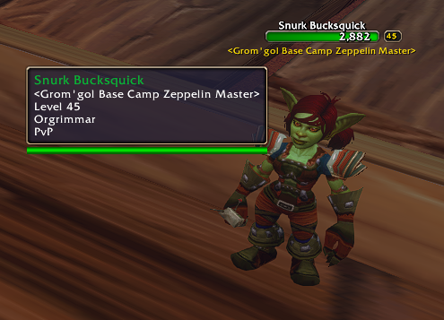

# Unified Conveniences

A lightweight WoW: Forever QoL addon.

## Features

- Shows destinations for Zeppelin Masters on mouseover tooltips and on friendly nameplates.
    - Adjusts label position with horizontal and vertical sliders (default: 0, 10).

  

## Installation

- Copy `UnifiedConveniences/` into `~/World of Warcraft/_forever_/Interface/AddOns/`